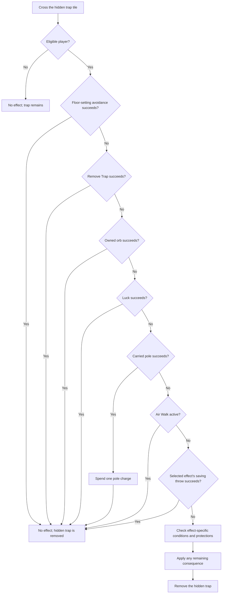

# Traps, Avoidance, and Stacking

Confictura has several different trap systems. A defense that stops a hidden floor trap may do nothing against a landmine, a trapped chest, or damage from a trap somebody else triggered. This guide explains what you can do, which protections work together, and what happens if they fail.

**Rules snapshot:** checked-in source and configuration at `0e65df39`, reviewed October 9, 2026. These are source-verified rules, not measurements from the live shard. World placements, staff-configured hazards, saved item properties, and deployment settings can differ. The current configuration uses Stygian Abyss rules and **disables item insurance**.

Use the [offline trap-avoidance calculator](../tools/trap-avoidance-calculator.html) for supported trigger, hidden-floor save, container, and detection calculations. Its percentages assume the selected effects are already active. It does not predict other players triggering area damage, every quest/custom hazard, or every inventory consequence. The distinctions below still matter when a calculator shows 100% avoidance.

## Contents

- [Practical starting advice](#practical-starting-advice)
- [The checks between a trap and its victim](#the-checks-between-a-trap-and-its-victim)
- [Which defenses work against which traps](#which-defenses-work-against-which-traps)
- [Finding traps before walking into them](#finding-traps-before-walking-into-them)
- [Passive avoidance and how it stacks](#passive-avoidance-and-how-it-stacks)
- [Equipment, elixirs, and skill caps](#equipment-elixirs-and-skill-caps)
- [Air Walk and immortality items](#air-walk-and-immortality-items)
- [Hidden floor traps and all 25 outcomes](#hidden-floor-traps-and-all-25-outcomes)
- [Protecting possessions and recovering losses](#protecting-possessions-and-recovering-losses)
- [Permanent floor and wall hazards](#permanent-floor-and-wall-hazards)
- [Trapped containers](#trapped-containers)
- [Player traps, landmines, and lethal tiles](#player-traps-landmines-and-lethal-tiles)
- [Theft pedestals, faction traps, and configured tiles](#theft-pedestals-faction-traps-and-configured-tiles)
- [Damage, poison, and defenses that are not universal](#damage-poison-and-defenses-that-are-not-universal)
- [Maintainer source reference](#maintainer-source-reference)

## Practical starting advice

1. **Search ahead and choose a clear route.** Stay outside the hazard's trigger and damage areas. Finding a trap does not normally disable it.
2. **Build displayed Remove Trap, carry an orb, add Luck, and carry a ten-foot pole.** On traps that use the common avoidance checks, these are separate opportunities to stop the trigger. A pole belongs in your backpack; you do not tap it manually.
3. **Check displayed skill after equipping your gear.** A common Remove Trap check is guaranteed at **126**, not 100 or 125. That guarantee does not apply to traps which never call that check or to collateral damage.
4. **Use Air Walk selectively.** It protects against random hidden floors and several other floor hazards, but not every trap. Its current duration is measured in seconds.
5. **Treat containers separately.** Disarm first, use a suitable alternative, or use Telekinesis from outside the damage radius after checking whether the chest is locked and how it triggers.
6. **Bank unnecessary valuables.** Some traps destroy supplies, reduce a raw stat, or move belongings. More HP and armor cannot prevent those effects. Small bags help against a few inventory searches, not all of them.
7. **Leave room around other adventurers.** Your personal avoidance chance does not shield you from every trap that another player activates.

The [defense matrix](#which-defenses-work-against-which-traps) and [possession table](#protecting-possessions-and-recovering-losses) give the exceptions. See [S01](#s01-common-avoidance), [S03](#s03-hidden-floor-effects), and [S07](#s07-world-hazards).

## The checks between a trap and its victim

These terms describe different results:

| Layer | What it does | What it does not establish |
|---|---|---|
| Detection | Reports a location or hazard | That the trap is disabled, visible as an item, or targetable |
| Route choice / distance | Keeps you out of the relevant tile or area | That another hazard or destination is safe |
| Active disarming | Removes a supported trap before triggering it | That every trap type accepts the same skill or spell |
| Eligibility / immunity | Prevents a particular trap path from acting on you | Protection against all other paths, victims, or inventory effects |
| Passive avoidance | Stops your qualifying trigger through a skill, orb, Luck, or pole check | A universal reduction to damage already being applied |
| Effect saving throw | Stops the selected hidden-floor effect after earlier checks fail | That resistance is always an avoidance roll in other trap families |
| Mitigation / recovery | Reduces damage, prevents poison ticks, protects selected items, or restores a loss | That no trap triggered |

Source: [S01](#s01-common-avoidance), [S03](#s03-hidden-floor-effects), [S07](#s07-world-hazards), [S08](#s08-containers), [S12](#s12-damage-and-poison).

For a normal, living player crossing a **random hidden floor trap**, the sequence is:



The selected effect can still do nothing after a failed save: for example, an ammunition trap might select bolts when you carry none. Conversely, a successful trigger can cost possessions or a raw stat without causing HP damage. The flowchart is for `HiddenTrap`; other families below have different sequences. Source: [S03](#s03-hidden-floor-effects).

## Which defenses work against which traps

**Common** means Remove Trap, then an owned orb, then Luck, then one carried pole. **Immortality** means the specific Gem or Jewel of Immortality being present in the backpack. Entries describe **your own trigger**, unless the row explicitly describes collateral damage. Character blessing and ordinary damage-system checks are discussed separately.

| Trap or damage path | Common checks | Air Walk | Immortality presence | Additional check or main avoidance option |
|---|---|---|---|---|
| Random hidden floor | Yes, after the floor-setting roll | Yes, after common checks | No | Effect-specific saving throw; inventory conditions/protection |
| Fire column | Yes | Yes | Yes | Direct damage requires the triggerer to be on its tile |
| Flame spurt: attempted tile crossing | Yes | Yes, before common checks | No direct check | Failed avoidance schedules two damage applications |
| Flame spurt: entering its one-tile neighborhood | No | No | No | Stay outside the area; separate 1-10 damage path |
| Gas trap | Yes | No | Yes | Poison severity and later poison protections |
| Giant spike | Yes | No | Yes | Direct damage requires the triggerer to be on its tile |
| Mushroom | Yes | No | Yes | Stay outside its two-tile trigger range |
| Saw | Yes | Yes | Yes | Avoid its tile |
| Spike: your trigger | Yes | Yes | Yes | Avoid its tile |
| Spike: victim of somebody else's trigger | No fresh checks | No fresh check | No fresh check | Do not share the trap's tile |
| Stone face: your trigger | Yes | No | Yes | Avoid entering its two-tile trigger area |
| Stone face: delayed area damage | No fresh checks | No | No fresh check | Be outside one tile when damage is selected |
| Player physical trap | Yes | Yes, before common checks | Yes | Owner does not trigger it |
| Player magical trap | Yes for players | Yes, before common checks | Yes | Owner immunity, then a separate Psychology check |
| Landmine | No | No | Yes | Owner immunity; avoid the tile or wait for decay |
| Lethal tile | No | Yes | Yes | Avoid the tile; otherwise attempts 10,000 direct damage |
| Trapped container | Different container chain | No | No trigger check | Active disarming, distance, suitable spells/tools/NPCs |
| Theft pedestal | Remove Trap only, after failed Snooping | No | No trigger check | Successful Snooping prevents the trap branch |
| Faction trap | No common passive chain | No | No trigger check | Faction eligibility; faction-specific active disarming |
| XML-configured tile | No built-in common chain | No built-in check | No built-in check | Its configured action determines the consequences |
| Open Ground spell chasm | No | No | No | A separate pit system; avoid the opening, including with pets |

Sources: [S01](#s01-common-avoidance), [S03](#s03-hidden-floor-effects), [S06](#s06-air-walk-and-immortality), [S07](#s07-world-hazards), [S08](#s08-containers), [S10](#s10-player-traps-and-chasms), [S11](#s11-pedestals-factions-and-xml-tiles).

## Finding traps before walking into them

### Detection options

These methods locate `HiddenTrap` and `BaseTrap` hazards. They do **not** provide a universal detector for containers, player traps, landmines, lethal tiles, Open Ground chasms, or configurable XML tiles.

| Method | How to use it | Item scan radius around the selected point | Cost or condition |
|---|---|---|---|
| Searching skill | Use Searching and target a point within 12 tiles | `floor(Searching / 10)` on success; half that radius, rounded down, on failure | Six-second skill reuse delay; cannot start while character-blessed |
| Magery Reveal | Cast and select a point within 10 tiles | `1 + floor(Magery / 20)` | Normal spell casting, resources, and targeting checks |
| Shinobi Eagle Eye | Cast and select a point within 10 tiles | `1 + floor(Ninjitsu / 20)` | Normal ability checks |
| Jedi Mind's Eye | Cast and select a point within 10 tiles | `1 + floor(Psychology / 20)` for items | Its mobile-reveal radius uses a different formula |
| Gem of Seeing | Double-click the gem while within three tiles of it, then select within 12 | Fixed radius 10 | Starts with 50 charges; spends a charge when opening targeting, even if you later cancel |

Source: [S04](#s04-detection-and-targeting). The current expansion supplies the 10-tile spell target ranges. A friend-house override gives Searching and Gem of Seeing radius 22.

Searching's full-radius success chance is `clamp(Searching / 126, 0, 1)`. Once a supported trap is inside the actual positive scan radius, there is no second individual trap-detection roll. Radius zero skips the scan. At Searching 100, the scan reaches 10 tiles about 79.37% of the time and five tiles otherwise: a supported trap five tiles from the selected point is found either way.

Scan distances are square distances: a tile five steps diagonally from the selected point is within radius five. Scan height behavior is different from movement-trigger height checks; a detection report alone does not establish a safe route through a multilevel area.

**Night Sight is not another passive floor-trap avoidance roll.** The active trap scan does not require the night-vision helper to succeed. Hiding and Stealth are not trap-detection skills. See the [Searching, Hiding, and Stealth guide](Searching_Hiding_Stealth.md) for the separate hidden-mobile contests.

### Finding is not the same as disarming

The ordinary detection paths send particles, sound, and a report; they do not set a hidden floor trap's `Visible` property to true and do not delete or disable it. The Remove Trap skill has a two-tile target handler that deletes a `HiddenTrap` on a successful 0-126 check, with safe failure and a five-second reuse delay. However, the normal target system rejects invisible items. **Do not rely on detecting an invisible floor trap and then clicking it to disarm it.** The handler is usable only if the item is actually visible/targetable through its state or a separate mechanism.

Standard saws, spikes, stone faces, and the other ordinary `BaseTrap` hazards are not accepted by that hidden-floor disarm branch. Container and faction disarming have their own branches. Source: [S04](#s04-detection-and-targeting), [S08](#s08-containers), [S11](#s11-pedestals-factions-and-xml-tiles).

## Passive avoidance and how it stacks

### The common sequence

For an eligible player, traps using the common helper check:

1. **Random hidden floors only:** the configured floor-setting avoidance roll.
2. **Remove Trap:** one skill check.
3. **Orb:** the first matching orb found in the backpack, if avoidance has not succeeded; on this path it must belong to you.
4. **Luck:** can prevent the remaining trigger.
5. **Pole:** the first matching pole found in the backpack, if avoidance has not succeeded.

A later success stops the remaining trigger; it does not add its percentage to an earlier percentage. The helper itself does not delete a trap. The caller decides whether an avoided trap remains, disappears, or resets. Messages saying "disabled" or "broke" do not override that caller's behavior.

The code can evaluate the Luck helper even when the trigger is already avoided, but that cannot create a second benefit. Orb and pole protection only act while the trigger remains unresolved. Source: [S01](#s01-common-avoidance).

| Defense | Chance on the common floor/wall path | Important limit |
|---|---|---|
| Hidden-floor setting | Current value: **20% avoidance** | Does not apply to other trap families; despite its name/comment, it is used as avoidance |
| Remove Trap | `clamp(displayed Remove Trap / 126, 0, 1)` | Applies only when the path calls this skill check |
| Orb | `min(100, floor(Magery at creation / 2) + 25)%` | Needs an existing, owned orb in the backpack |
| Luck | `floor(min(Luck, 2000) × 0.04)%`; zero for Luck <= 0 | Maximum 80%; integer steps |
| Pole | Its material/weight chance, normally 50-92% | One matching pole, with one charge spent only on successful pole avoidance |

Source: [S01](#s01-common-avoidance), [S02](#s02-skills-and-modifiers), [S05](#s05-orbs-poles-and-skill-equipment). Percentages are conditional on valid items and normal player state.

Luck moves in integer percentage steps: 24 Luck gives 0%, 25-49 gives 1%, 50 gives 2%, 1,999 gives 79%, and 2,000 or more gives 80%. Adding Luck inside the same step does not change this particular roll.

### What 100, 125, and 126 actually mean

| Displayed Remove Trap | Chance the common skill check succeeds | Chance it fails |
|---:|---:|---:|
| 0 | 0% | 100% |
| 50 | 39.6825% | 60.3175% |
| 100 | 79.3651% | 20.6349% |
| 105 | 83.3333% | 16.6667% |
| 110 | 87.3016% | 12.6984% |
| 115 | 91.2698% | 8.7302% |
| 120 | 95.2381% | 4.7619% |
| 125 | 99.2063% | 0.7937% |
| 126 or higher | 100% | 0% |

Source: [S02](#s02-skills-and-modifiers). The central skill wrapper changes a requested maximum of 100 or more to **126**. It does not simply add one to the requested maximum. Each trained +5 in this table adds about 3.9683 percentage points to this check alone.

### Combining the checks

Use decimal probabilities, so 75% becomes `0.75`. Let `R`, `O`, `L`, and `P` be the Remove Trap, orb, Luck, and pole chances. An absent or inapplicable method has chance zero.

```text
Chance all common defenses fail = (1-R) × (1-O) × (1-L) × (1-P)
Chance at least one works       = 1 - chance all fail

Random hidden floor, before Air Walk and the effect save:
    chance reaching the effect layer = 0.80 × (1-R) × (1-O) × (1-L) × (1-P)

For a particular applicable hidden-floor effect with save chance S:
    chance reaching its consequence checks = chance reaching the effect layer × (1-S)
```

Air Walk makes the last two risks zero on this particular hidden-floor path while active. Conditional item requirements, poison prevention, and actual damage processing can reduce the remaining consequence further. A general random floor can select an effect that has no applicable victim item at all.

**Worked example:** displayed Remove Trap 100, Magery 100 when creating the orb (75% power), Luck 1,000 (40%), and a plain pole (50%).

| Remaining event | Calculation | Chance |
|---|---|---:|
| Common checks all fail | `(26/126) × 0.25 × 0.60 × 0.50` | 1.5476% |
| Hidden-floor checks reach the effect layer | Previous result × `0.80` | 1.2381% |
| An applicable effect also defeats a 60% save | Previous result × `0.40` | 0.4952% |

Source: [S01](#s01-common-avoidance), [S03](#s03-hidden-floor-effects). This is not a universal 0.4952% chance of taking damage from anything called a trap.

For `n` independent, equivalent encounters with unchanged protection and per-encounter risk `q`, the chance of at least one such failure is `1 - (1-q)^n`. Real travel can violate these assumptions: poles break, buffs expire, traps differ, and other players can trigger area damage.

### Orbs and poles in practice

Cast Magery **Remove Trap** on yourself to create an Orb of Trap Finding in your backpack. Targeting a container instead uses a different disarm effect. The orb lasts 30 minutes, is removed on server load, and records your Magery when created. Later equipment changes do not recalculate its power. Recasting successfully deletes your existing orbs before creating one replacement; it does not stack their powers or durations.

Magery 50/100/125/150 produces orb power 50/75/87/100 respectively. A wand of trap removal is a casting item; the resulting **orb** is the passive protection. Normal spell or wand-use prerequisites remain separate from these protection percentages.

Backpack item searches include nested containers and return the **first matching item**, not the strongest. Carrying several poles provides replacements, not multiple avoidance rolls. Multiple orbs do not combine; on floor/wall checks, an unowned orb found first can prevent the helper from considering your owned orb. Keep the intended protection in an unambiguous inventory arrangement.

| Normal pole material | Weight | Common-path avoidance |
|---|---:|---:|
| Ordinary wood | 40 | 50% |
| Ash | 39 | 53% |
| Cherry | 38 | 56% |
| Ebony | 37 | 59% |
| Golden oak | 36 | 62% |
| Hickory | 35 | 65% |
| Mahogany | 34 | 68% |
| Driftwood | 33 | 71% |
| Oak | 32 | 74% |
| Pine | 31 | 77% |
| Ghostwood | 30 | 80% |
| Rosewood | 29 | 83% |
| Walnut (some names spell it "valnut") | 28 | 86% |
| Petrified wood | 27 | 89% |
| Elven wood | 26 | 92% |

Source: [S05](#s05-orbs-poles-and-skill-equipment). A normal new pole has 20 charges. Earlier successful defenses spare its charges; a failed pole roll spends none. The last successful charge still protects you, then breaks the pole. The rule reads actual weight, not the wood's name; nonstandard weights must use the actual step function. In particular, 25 or less falls back to 50%, not a better chance.

## Equipment, elixirs, and skill caps

Most trap checks use **displayed total skill**, including applicable equipment and temporary bonuses. A power scroll changes a training cap; it does not immediately add trained skill or create a separate trap-defense roll. The current skill calculation normally limits an unboosted total to 125, but a positive bonus that is allowed to exceed the cap can take it above that. Equipped skill bonuses use that capability.

| Item or effect | Relevant contribution | Stacking rule |
|---|---|---|
| Gray Mouser's Cloak / Cloak of the Rogue | +80 Remove Trap; +25 Snooping and Stealing; +10 Dexterity | Equipped bonuses improve their respective checks; Dexterity can separately improve an applicable save |
| Torch of Trap Burning (`Artifact_TorchOfTrapFinding`) | +100 Remove Trap | Must be equipped; uses the two-handed equipment slot |
| Detective Boots of the Royal Guard | Independently rolled +10-25 Remove Trap, Searching, Psychology, Lockpicking, and Snooping; +10 Intelligence | Use the actual bonuses on your boots; each skill helps only its applicable system |
| Wand of trap removal | +20 Magery while equipped; casts Remove Trap | Can improve orb power at creation; it is not another passive orb roll |
| Elixir of Removing Trap | Temporary bonus calculated below | Adds to displayed Remove Trap; another of the same elixir cannot stack while active |
| Other applicable skill, Luck, stat, or resistance bonuses | Changes the input read by a defense | No separate roll merely because a second item supplies the same stat |

Source: [S02](#s02-skills-and-modifiers), [S05](#s05-orbs-poles-and-skill-equipment). Names can change through artifact setup or saved items; inspect actual properties. Equipment must satisfy ordinary slot and equip restrictions. The old cloak/torch classes also grant the listed large Remove Trap bonuses; their filename being "Obsolete" does not make them absent from runtime compilation.

For example, a character with 50 base Remove Trap and a working +80 equipped bonus reaches 130 displayed skill and guarantees the **common skill check**. That does not protect against landmines, lethal tiles, faction passive triggers, or another person's stone-face blast. Pedestals offer their own Remove Trap fallback, which this same high displayed skill can satisfy; it does not make their Snooping or Stealing checks succeed.

### Elixir formula and duration

For this elixir, let `E` be effective Enhance Potions. It is equipment Enhance Potions capped at 50, plus an Alchemy bonus of 10 at 3.3 displayed Alchemy, 20 at 6.6, or 30 at 9.9 and above. Those unexpectedly low thresholds come from comparing fixed tenths to 33/66/99.

```text
potential bonus = 10 + floor(E/8) + floor(Cooking/5) + floor(Tasting/5)
actual bonus    = min(potential bonus, max(1, 125 - floor(base Remove Trap)))
duration        = floor((120 + 2E + 2floor(Cooking) + 2floor(Tasting)) / 120) minutes
```

Source: [S05](#s05-orbs-poles-and-skill-equipment). The code produces **one minute** with all contributing inputs zero, despite a comment saying two minutes minimum.

At Cooking 100, Tasting 100, and effective Enhance Potions 80, the potential bonus is +60 and duration is five minutes. It becomes +25 at base Remove Trap 100, or +1 at base 125. The limiter reads base skill, so existing equipment bonuses do not reduce that calculation. At base 125, the +1 can make the displayed total 126.

You can have up to two elixir effects active together. You cannot drink another Removing Trap elixir while its own effect is active. Expiration removes the bonus and explicitly reveals the drinker, so plan around it when sneaking.

Other skill elixirs help only the check that reads their skill. They use the same potential-bonus/base-skill limiter, substituting their own skill. Their duration denominator is shown below: use the numerator from the formula above and round down after dividing by **120 or 60**, in minutes.

| Elixir | Relevant use | Duration denominator |
|---|---|---:|
| Searching | Active detection radius and full-radius check; faction proximity detection | 120 |
| Psychology | Magical ground trap's extra avoidance check; Mind's Eye item radius; Air Walk duration when cast | 60 |
| Magic resistance | Hidden-floor Magic save, up to its 60% cap | 60 |
| Poisoning | Hidden-floor Poison save, up to its 60% cap | 120 |
| Snooping | Pedestal's first check | 120 |
| Tinkering | Faction disarming's second required check | 120 |
| Forensics | Phantasm's container-level comparison | 60 |
| Spiritualism | Air Walk duration when cast | 60 |
| Stealing | Obtaining the pedestal prize after Snooping succeeds; does not replace the trap-avoidance checks | 120 |

Source: [S05](#s05-orbs-poles-and-skill-equipment), with each skill's use traced in S03/S04/S06/S08/S10/S11. For example, the same Cooking 100/Tasting 100/Enhance Potions 80 inputs produce **11 minutes** for a denominator-60 elixir, versus five for a denominator-120 one. Skill boosts to a save already at 60% do not raise that save further.

## Air Walk and immortality items

### Air Walk

Air Walk is the research spell that gives the specific protection in the matrix. It is not ordinary flight, a mount, Hiding, or Stealth. Consult [Research Magic](Research_Magic.md) for the research system and casting prerequisites. Its metadata lists 65 required skill, 55 mana, and Spider's Silk, Pixie Skull, and Butterfly Wings.

```text
duration in seconds = floor((Necromancy + Magery + Spiritualism + Psychology) / 6)
```

Source: [S06](#s06-air-walk-and-immortality). Values are displayed skills. All four at 100 give 66 seconds; all four at 125 give 83 seconds. The lore's "20-80 minutes" does not match this timer.

Recasting does not add duration. The spell clears the current effect flag and starts a new timer, but does not cancel the earlier timer; the earlier timer can end the recast effect. Do not rely on early recasts to extend protection past the original expiration.

On hidden floors, fire columns, saws, and spikes, common avoidance is evaluated **before** Air Walk. A pole can therefore spend a successful charge even though Air Walk would have protected you later. On player physical/magical traps and the flame-spurt crossing path, Air Walk is checked earlier. It does not suppress the separate flame-spurt proximity hit, gas, mushrooms, giant spikes, stone faces, containers, landmines, or Open Ground chasms.

### Gem and Jewel of Immortality

Some trap handlers return immediately when they find a **Gem of Immortality** or **Jewel of Immortality** anywhere inside the backpack. These presence checks do not spend a charge or consume the item. Two such items do not create two avoidance rolls.

This is separate from their rescue behavior when a player would die: the Jewel is consumed and restores HP; the Gem consumes a charge and restores HP, mana, and stamina. Both rescue paths cure poison. A rescue does not prevent an earlier raw-stat loss, destroyed possession, curse, or teleport.

Random `HiddenTrap` floors do not check these items for trigger immunity. Most ordinary `BaseTrap` hazards do, but spike/stone-face collateral victims do not get their own presence checks. Flame-spurt visual-refresh code notices these items, but that is not reliable damage immunity for either of its damage paths. See [S06](#s06-air-walk-and-immortality) and [S12](#s12-damage-and-poison).

## Hidden floor traps and all 25 outcomes

### Eligibility, selection, and disappearance

A normal `HiddenTrap` is an invisible, immovable marker activated by crossing its tile at an overlapping height. Only player characters proceed through its effect handling. Dead players, character-blessed players, and staff above Player access are skipped before consumption.

For an eligible player, the marker is deleted after the crossing attempt even if the floor-setting roll, Remove Trap, orb, Luck, pole, Air Walk, saving throw, or an empty inventory prevents consequences. That removes this marker, not every trap nearby; world spawning can place replacements. Nearby ambient dungeon sounds are not proof that you have triggered it.

The usual unset marker chooses uniformly among types 1-25 after common avoidance fails. A configured positive type selects that effect instead. On spaceship locations, the code overrides the selection with an equal choice from **1-9, 11, 16, 18-23**: 17 possibilities. Ship messages describe loose plates, contamination, power equipment, and similar hazards instead of medieval traps.

Source: [S03](#s03-hidden-floor-effects), [S13](#s13-world-data-and-snapshot).

### Saving throws

Each selected effect uses one of these saves. Round the score down for ordinary nonnegative values, then cap it at 60. The score is a percentage chance to prevent that effect. Nonpositive scores cannot succeed.

| Save | Score before the 60% cap | Effects that use it |
|---|---|---|
| Magic | `floor((Intelligence + Magic Resist skill + Energy Resistance) / 4)` | Reveal, coins, equipment destruction, raw-stat loss, drain, gems, reagents, books, teleport, fame, curse, jewelry, karma |
| Physical | `floor((Strength + Physical Resistance) / 3)` | Hidden spikes, saw, giant spike |
| Agility | Dexterity | Dropping belongings, broken ammunition, broken potions, pit |
| Fire | `floor((Dexterity + Fire Resistance) / 3)` | Hidden flame and explosion |
| Poison | `floor((Strength + Poisoning skill + Poison Resistance) / 4)` | Hidden poison and tainted bandages |
| Energy | `floor((Intelligence + Energy Resistance) / 3)` | Hidden electrical trap |

Source: [S03](#s03-hidden-floor-effects), `SavingThrow`. Skills are displayed totals; stats and resistances are their current values. A Cold save helper exists but none of the 25 hidden-floor outcomes selects it.

Examples: Dexterity 60 already reaches the Agility save's 60% cap. Strength 100 and Physical Resistance 70 give a 56% Physical save. Intelligence 100, Magic Resist 100, and Energy Resistance 70 would give 67 before capping, so the actual Magic save is 60%. Increasing a capped save does not add another roll, although a resistance increase can still reduce damage after a failed save.

### Complete outcome table

Every row below assumes earlier defenses and its listed saving throw have failed. "Raw hit" is the amount before the stated resistance reduction and any later damage-system behavior. Inventory details and recovery exceptions follow the table.

| Type | Effect | Save | Consequence and practical limit |
|---:|---|---|---|
| 1 | Revealing trap | Magic | Reveals a hidden character; already-visible characters have nothing to lose from this effect |
| 2 | Trip wire / loose plate | Agility | 1 in 5 selects a backpack spill; otherwise selects one eligible equipped item to drop on the floor |
| 3 | Coins to lead | Magic | Converts carried gold, copper, silver, and xormite coin counts into lead coins, including nested bags |
| 4 | Destructive / rust trap | Magic | Deletes one selected equipped item; creates rusty or broken junk in its place, not a repairable copy of the original |
| 5 | Raw-stat loss | Magic | Uniformly picks Strength, Dexterity, or Intelligence; subtracts one **raw** point if that stat exceeds 10; no timed restoration |
| 6 | Poison gas / contamination | Poison | Applies poison selected by the resistance-based severity table below |
| 7 | Drain | Magic | Uniformly sets HP to 1, stamina to 0, or mana to 0; this is a direct vital assignment, not an ordinary resisted hit |
| 8 | Fused gemstones | Magic | Deletes supported gems throughout the backpack; replaces them with a fused lode stone weighing five units per destroyed gem |
| 9 | Rotted reagents | Magic | Destroys recognized reagents directly in the main backpack; creates useless rotted reagents |
| 10 | Book binding | Magic | Moves affected spellbooks/runebooks into a locked magical BookBox; the books still exist |
| 11 | Teleport | Magic | Selects a random land destination in the current world grouping and teleports the player and qualifying following pets; no move if the destination helper returns no point |
| 12 | Forgotten fame | Magic | If Fame is positive, computes `floor(0.80 × Fame)` and assigns it only if the result is positive; Fame 1 therefore remains 1 |
| 13 | Cursed equipment | Magic | Wraps one selected equipped item in a cursed container in the backpack; original item can be recovered |
| 14 | Floor spikes | Physical | Raw hit 50-200, reduced by Physical Resistance |
| 15 | Saw blades | Physical | Raw hit 50-200, reduced by Physical Resistance |
| 16 | Flame / thermal vent | Fire | Raw hit 50-200, reduced by Fire Resistance |
| 17 | Giant spike | Physical | Raw hit 50-200, reduced by Physical Resistance |
| 18 | Explosion / plasma grenade | Fire | Raw hit 50-200, reduced by Fire Resistance |
| 19 | Electrical tile | Energy | Raw hit 50-200, reduced by Energy Resistance |
| 20 | Broken ammunition | Agility | Randomly selects arrows or bolts, then converts all carried stacks of that chosen type, including nested stacks, into shafts |
| 21 | Tainted bandages | Poison | Destroys carried Bandage stacks throughout the backpack; substitutes unusable tainted bandages |
| 22 | Broken potions | Agility | Deletes recognized potion items directly in the main backpack |
| 23 | Melted jewelry | Magic | Deletes non-blessed recognized jewelry in the main backpack and specified equipped jewelry slots; substitutes a junk puddle |
| 24 | Pit | Agility | Records the return location and moves the player into the shared pit; qualifying pets are sent to its bottom; no direct damage call in this branch |
| 25 | Alignment reversal | Magic | If Karma is nonzero, reverses its sign; at zero it has no effect and does not roll the save |

Source: [S03](#s03-hidden-floor-effects). A recorded consequence also reveals a hidden player. Saved effects and game messages are not a reliable way to count every attempted trigger, because several no-effect branches do not report a consequence.

For the six direct-damage rows, the local formula is `floor(raw hit × (100 - relevant resistance) / 100)`, followed by direct damage processing. At resistance 70, a raw range of 50-200 becomes 15-60 before later modifiers. The Physical/Fire/Energy save is an earlier, separate chance to stop that hit entirely.

### Poison severity

This table is used by hidden poison floors, ordinary gas traps, poisonous mushrooms, trapped-container poison, and the poison-colored player magical trap. It is **not** the faction-gas or theft-pedestal poison table.

| Current Poison Resistance | Equally likely poison strengths before later modifications |
|---:|---|
| 70 or more | Lesser only |
| 50-69 | Lesser, Regular |
| 30-49 | Lesser, Regular, Greater |
| 10-29 | Lesser, Regular, Greater, Deadly |
| Below 10 | Lesser, Regular, Greater, Deadly, Lethal |

Source: [S03](#s03-hidden-floor-effects), [S07](#s07-world-hazards), [S08](#s08-containers), [S10](#s10-player-traps-and-chasms). Resistance 70 does not mean poison cannot be applied; it limits this selection to Lesser. Poison immunity, automatic curing, and tick damage are [later checks](#damage-poison-and-defenses-that-are-not-universal).

## Protecting possessions and recovering losses

### What bags, blessing, and insurance really protect

**Item blessing and character blessing are different.** An item with blessed loot status is protected only where the relevant effect checks it. It does not make its wearer immune. Current item insurance is disabled; do not count an old insured flag as protection.

| Consequence | Does an ordinary nested bag help? | What blessing or insurance checks apply? |
|---|---|---|
| Backpack spill | No, if that bag itself is moved | The spill moves each non-blessed top-level item, including whole containers; no insurance check. A blessed top-level container is left in place with its contents |
| Equipped-item drop | Unequipping into the pack removes the item from this selector | Selector normally skips blessed gear; no insurance check; special talisman-book exception below |
| Coins to lead | No; carried coin lookup/consumption recurses | No per-coin blessing or insurance check |
| Equipment destruction or curse | Unequipped items are not selected by this particular effect | Selector normally skips blessed gear; an additional insurance helper is called only when insurance is enabled |
| Fused gems | No; each supported gem-type search recurses | No per-gem blessing or insurance check |
| Rotted reagents | **Yes**, against this specific top-level scan | No individual blessing or insurance check |
| Book binding | Ordinary bags do not stop recursive book scans | Backpack spellbooks skip blessed items and use the insurance helper; equipped spellbooks and runebooks follow different rules below |
| Broken ammunition | No; chosen ammunition-type search recurses | No per-stack blessing or insurance check |
| Tainted bandages | No; Bandage search recurses | No per-stack blessing or insurance check |
| Broken potions | **Yes**, against this specific top-level scan | No individual blessing or insurance check |
| Melted jewelry | **Yes** for unequipped jewelry in nested bags | The top-level/equipped jewelry scan skips blessed jewelry; it does not check insurance |

Source: [S03](#s03-hidden-floor-effects), [S09](#s09-inventory-protection-and-recovery). A bag is not a universal shield: even a useful nested bag can itself be spilled by another trap. Banking unnecessary possessions keeps them out of these backpack/equipment scans.

**Equipment selection:** the drop, destruction, and curse effects use a random starting order across 20 equipment slots, then choose the first eligible occupied slot in that order. It is not an equal lottery across your currently worn items. Most blessed items are excluded, but a `Spellbook` worn in the **talisman slot** bypasses the selector's blessing exclusion. With insurance disabled, do not assume a blessed talisman-slot spellbook is safe from those selectors.

**Books:** the binding trap automatically includes spellbooks in the one-handed and talisman slots, even when blessed. Within the backpack, blessed spellbooks are skipped; unblessed spellbooks can use the conditional insurance helper. Runebooks are included without those blessing/insurance checks. Books whose immediate parent is already a BookBox are skipped by the recursive backpack scans. Store a blessed spellbook in the backpack rather than equipping it if your goal is to avoid this particular binding effect.

**Jewelry:** the melt scan checks recognized `BaseJewel` items directly in the backpack and in bracelet, ring, helm, neck, and earrings slots. It does not destroy every item merely because it has magical properties. **Gems:** the fuse scan includes Ruby, Amber, Amethyst, Citrine, Emerald, Diamond, Sapphire, Star Sapphire, Tourmaline, relic gems, and Mage Eyes.

If insurance is enabled in a different deployment, the helper protects a qualifying already-insured item from that encounter, then handles renewal. Auto-renew tries to withdraw **900 gold per checked item**. Insufficient funds or disabled auto-renew clears its insured flag for later encounters but does not revoke protection for the current helper call. This helper is not used by all item-loss effects. It also returns protection for blessed items when actually called. Source: [S09](#s09-inventory-protection-and-recovery).

### Recovering afterward

| Loss or condition | Available response |
|---|---|
| Dropped equipment | Retrieve the item from the floor; the trap does not bind it to its former owner |
| Spilled backpack contents | Retrieve them promptly from the dropped backpack. It is immovable, has no owner check in its class, expires after about 30 minutes, and is deleted on server load |
| Cursed equipment / BookBox | Give the container to a suitable magic/chivalry vendor, or use a supported curse-removal ability; the original contents are retained |
| Rusted/broken equipment, melted jewelry | The trap deletes the originals. Junk substitutes do not retain the original item for normal repair |
| Fused gems, rotten reagents, tainted bandages, broken potions | Replace the supplies. The substitute-item handlers provide no restoration action |
| Broken arrows/bolts | The trap returns shafts, not the original ammunition |
| Lead coins | A Magic Pool has a possible gold-conversion outcome that converts carried lead coins to gold by count; it is a random pool outcome, not a guaranteed cleansing service or restoration of original denominations |
| Raw-stat loss | The lost raw point has no expiration timer; normal future stat development is separate from undoing the trap |
| HP/stamina/mana drain | Replenish the affected vital normally; armor did not prevent the assignment |
| Fame loss / reversed Karma | Later reputation changes can change these values again; the trap itself supplies no timed reversal |
| Teleport / pit | Regroup with pets and use available travel or the area's return mechanism. The trap records a pit return location but this review does not verify the live pit's exit placement or subsequent fall/environmental hazards |
| Poison | Cure or rely on applicable poison prevention; curing does not restore supplies lost to a different poison-save effect |

Source: [S09](#s09-inventory-protection-and-recovery), [S12](#s12-damage-and-poison).

The shared vendor handler frees books and cursed equipment when handed to a Mage, Keeper of Chivalry, Witch, Necromancer, Mage Guildmaster, Holy Mage, or Necro Mage; that handler does not charge gold for this service. Local availability is a world-placement question. Knight Remove Curse can free the containers with positive Karma and a `Knightship / 126` item check. Death Knight Hag's Hand uses negative Karma and the same Knightship check; its enchantment variant also has an item recovery path. These restore the trapped contents, not equipment already deleted by a destructive trap.

## Permanent floor and wall hazards

These are separate objects from the 25-outcome hidden marker. Most use `BaseTrap` movement checks: entering the trap tile is an active trigger; certain classes also trigger when entering a larger neighborhood. Staying motionless does not cause the base movement handler to tick repeatedly. A radius is square distance, with an additional height-overlap check for the initial trigger. Ordinary walls and line of sight are not universal barriers to these handlers.

Unless a row says otherwise, the initial victim must be a living player with ordinary Player access. Common avoidance handles character blessing; the seven ordinary hazards other than flame spurts also check backpack Gem/Jewel of Immortality presence. The matrix above lists which accept Air Walk. None of these uses the random hidden floor's 20% roll or its effect saving throws.

| Hazard | Trigger and possible victims | Effect after failed defenses | Reset / disappearance and practical avoidance |
|---|---|---|---|
| Fire column | Enter its tile or three-tile neighborhood; only the triggerer on its actual tile takes the hit | Raw 50-200 Fire; local Fire Resistance reduction, then a typed hit after 0.5 seconds with another resistance reduction | Remains; active reset 0.5 seconds, proximity delay two seconds. Keep off the tile; common checks, immortality presence, and Air Walk can stop your trigger |
| Giant spike | Enter tile or three-tile neighborhood; only triggerer on actual tile is damaged | Raw 50-200, locally reduced by Physical Resistance; short delayed direct hit | Remains; no additional base reset delay. Common checks and immortality presence work; Air Walk does not |
| Gas | Enter tile; only triggerer | Applies poison using the resistance-based severity table; a gas trap with a null poison property does nothing | Remains; no base reset delay. Common checks, immortality presence, and later poison protections; Air Walk does not work |
| Mushroom | Enter tile or two-tile neighborhood while the mushroom is in its active form; only triggerer | One of three mushroom modes: raw 40-200 Physical explosion after 0.5 seconds, resistance-selected poison, or raw 40-200 Energy damage. Damage is locally resisted once | Becomes inactive; after two seconds resets in a dungeon region, otherwise disappears. Common checks and immortality presence; stay more than two tiles away |
| Saw | Enter tile; only triggerer | Raw 50-200 Physical, locally resisted once, short delayed direct hit | Remains; no base reset delay. Common checks, immortality presence, Air Walk, or route around it |
| Spike | Enter tile starts the trap; then it selects living player victims sharing its tile | Raw 50-200 Physical for **each selected victim**, locally resisted once, short delayed direct hits | Remains; six-second active reset. Triggerer gets common checks, immortality presence, and Air Walk; collateral victims do not repeat them |
| Stone face | Enter tile or two-tile neighborhood starts breathing; **one second later** it selects living ordinary-access players within one tile | Raw 50-200 Fire per selected victim, locally resisted once, short delayed direct hits | Remains; breathing ends after two seconds. Triggerer gets common checks and immortality presence; move outside one tile before damage selection. Air Walk does not work |
| Flame spurt | Two distinct paths: attempting its tile, and entering its one-tile neighborhood | Crossing failure: raw 50-200 Fire, locally resisted once, applied immediately **and again** through a short delay. Proximity: separate 1-10 direct damage | Remains. Air Walk allows the crossing; otherwise even successful common avoidance blocks that crossing attempt. Proximity damage ignores those checks; stay more than one tile away |

Source: [S07](#s07-world-hazards), with damage dispatch in [S12](#s12-damage-and-poison). A "short delay" here is scheduled using one .NET tick; that does not guarantee a one-tick real-world timer response. Damage values are before later damage modifiers. The non-damaging stone-face subclass, used by decorative flaming heads, overrides the damage action with an empty method.

### Why your partner can still get you hurt

A spike checks the person who activates it, then loops over players sharing its tile. A stone face checks its triggerer, then later loops over its damage area. Those loops do not call each victim's Remove Trap, orb, Luck, pole, Air Walk, or immortality-presence checks. They also do not repeat the original trigger's height test for each victim. Ordinary damage processing still applies, including character blessing where relevant.

For example, a character with Remove Trap 126 carrying a Gem of Immortality can avoid starting a stone face themselves but still take the face's blast after another player starts it. The gem might later rescue a lethal hit, consuming a charge; that is a different mechanism. Distance before the victim-selection moment is the dependable way to avoid that collateral selection. Once a delayed hit has already selected its target, moving farther away does not automatically cancel it.

Flame spurts deserve extra care. Air Walk is checked before their tile-crossing avoidance, but the separate proximity handler does not check Air Walk. Passing the common check without Air Walk returns a blocked crossing, not free passage. When that crossing's defenses fail, its two damage calls both exist in source; count neither the visual flame nor a single message as proof that only one hit can occur. Source: [S07](#s07-world-hazards), [S12](#s12-damage-and-poison).

## Trapped containers

### Trigger, eligibility, and clearing the trap

Containers use their own sequence. Opening a qualifying trapped container, activating its Telekinesis handler, or lockpicking one configured to trap on lockpick can call it. The base trap routine exempts Game Masters and above; it does not use the ordinary floor eligibility, Air Walk, or immortality-presence gates. Normal access, lock, targeting, and later damage/poison rules still apply.

The sequence is **Remove Trap → Luck → orb → pole → trap effect**. Luck/orb/pole checks require a backpack. The orb lookup does **not** check its owner on this path, and its power is compared to container level, not to 1-100. A success clears the trap for everybody; it is not just personal immunity for this opening.

If the trap fires, the routine also clears it even if you were outside its damage radius or poison was prevented. A firing trap stops that opening attempt; the next valid opening can proceed. Successful passive disarming can open it on the same attempt. This does not destroy the chest or its loot, and a separate lock can still matter. These rules describe the base container implementation; a custom subclass can add behavior. Source: [S08](#s08-containers).

### Exact level formulas

Let `T` be Trap Level, `R` displayed Remove Trap, `a = 10T`, and `b = a + 20`.

```text
Skill eligibility: floor(R) must be at least a.
Skill maximum:    M = b when b < 100; otherwise M = 126.
Disarm chance:    0 below eligibility; otherwise clamp(R / M, 0, 1).

Orb/pole chance:  clamp((floor(power) - a + 1) / 21, 0, 1).
                 This counts integers in the inclusive roll a..b.

Remaining trigger chance = (1-skill) × (1-Luck) × (1-orb) × (1-pole).
```

On passive opening, a too-low skill still makes a skill call, potentially for skill development, but its success is ignored. Active Remove Trap instead reports that the trap is too complicated. Neither converts being below the threshold into a useful skill-based disarm chance.

| Trap Level | Required integer Remove Trap | Effective check maximum | At skill 100 | At skill 125 | At skill 126 |
|---:|---:|---:|---:|---:|---:|
| 0 | 0 | 20 | 100% | 100% | 100% |
| 1 | 10 | 30 | 100% | 100% | 100% |
| 5 | 50 | 70 | 100% | 100% | 100% |
| 7 | 70 | 90 | 100% | 100% | 100% |
| 8 | 80 | 126 | 79.3651% | 99.2063% | 100% |
| 10 | 100 | 126 | 79.3651% | 99.2063% | 100% |
| 12 | 120 | 126 | 0% | 99.2063% | 100% |
| 13 | 130 | 126 | 0% | 0% | 0% |

Source: [S08](#s08-containers), [S02](#s02-skills-and-modifiers). The threshold and roll maximum are **separate gates**. At level 13, skill 130 clears both; skill 126 does not pass the threshold. Do not assume every container's level is between one and five. Magery's Magic Trap can assign a container a level up to 90, based on integer Magery.

Examples for item power:

| Container | Orb power 75 | Plain pole power 50 | Elven pole power 92 |
|---|---:|---:|---:|
| Level 5; roll 50-70 | 100% | 1/21 = 4.7619% | 100% |
| Level 7; roll 70-90 | 6/21 = 28.5714% | 0% | 100% |
| Level 8; roll 80-100 | 0% | 0% | 13/21 = 61.9048% |
| Level 10; roll 100-120 | 0% | 0% | 0% |

Source: [S08](#s08-containers). Even the maximum ordinary orb power of 100 gives only 1/21 at level 10, and zero at level 11. Luck remains the usual percentage and is checked before these items. A pole still spends a charge only on its own successful disarm.

For a level-eight chest, Remove Trap 100, Luck 1,000, orb power 75, and an elven pole: remaining trigger chance is `(26/126) × 0.60 × 1 × (8/21) = 4.7166%`. This is a chance the **effect routine runs**, before distance, poison, and damage checks.

### Container effects and distance

| Type | Victim and range from container | Remaining effect |
|---|---|---|
| Explosion | Activating character within three tiles | Raw 50-200 Fire; local Fire Resistance reduction followed by typed Fire damage, applying resistance again |
| Dart | Activating character within three tiles | Raw 50-200 Physical; local Physical Resistance reduction followed by typed Physical damage, applying resistance again |
| Poison | Activating character within three tiles | Poison selected by the shared resistance-based severity table |
| Magic | Activating character within one tile | Raw 50-200, reduced by `min(90, floor((Remove Trap + Energy Resistance) / 3))%`, then direct damage |

Source: [S08](#s08-containers), [S12](#s12-damage-and-poison). These are hits on the activator, not an area explosion selecting bystanders. `TrapPower` is not used as the damage amount by these four base effects. The Magic reduction is neither a saving throw nor the character's general Magic Resist skill.

For example, a raw 100 explosion with Fire Resistance 70 becomes 30 in the container, then 9 in typed damage before other modifiers. For a Magic trap, Remove Trap 100 plus Energy Resistance 70 gives a 56% reduction, leaving 44 from a raw 100. At a sum of 270 or more the reduction caps at 90%; reaching that cap does not disable the trap.

### Disarming and other container options

| Method | What works | Conditions and limits |
|---|---|---|
| Active Remove Trap skill | Clears type, level, and power | Target within two tiles; level threshold and skill formula above; five-second reuse delay. Failure does not set it off |
| Magery Remove Trap, cast on the container | Clears type, level, and power | Valid spell/target and **integer Magery > 12 × Trap Level**; strict greater-than comparison, not a percentage roll |
| Phantasm, the undead/Witch magic effect | Clears type, level, and power | Valid casting/targeting, with **integer Forensics >= Trap Level**; its casting skill is Necromancy. Forensics is the level comparison, not Necromancy |
| Telekinesis | Runs the container's supported remote-open trap path | Stay **at least four tiles away** to be outside all four base effect radii. Magic alone needs two tiles. Current spell target range is ten, subject to visibility/access/line of sight |
| Bottle of acid / plasma torch | Can unlock and remove a trap, or remove only its trap | On a supported non-treasure-map lockable container: Required Skill <= 100 allows unlocking and trap removal; otherwise a present trap with positive Trap Level can be removed while the lock remains |
| Thief NPC's unlocking service | Unlocks and clears the lock/trap values | Context-menu service targets within 12 tiles; ordinarily 1,000 backpack gold, with a Begging-related discount. Refuses a BookBox |
| Appropriate citizen service | A configured thief-type citizen can unlock and clear lock/trap values | Depends on the NPC's configured type/service and access to that service; do not assume every citizen offers it |

Source: [S08](#s08-containers). Spells still have their ordinary casting prerequisites; deterministic post-cast comparisons are not guarantees that the cast itself succeeds. Acid and plasma torches refuse treasure-map chests and cursed/book containers. They are consumed in the relevant attempted-use branches, including a refused treasure-map chest; do not test them on a valuable consumable assuming failure is free.

The Magery spell requires integer skill **13 / 61 / 97 / 121 / 133** at trap levels **1 / 5 / 8 / 10 / 11** respectively. Magery 125 therefore meets its test through level 10, not level 11. The self-targeted orb is the other use of that same spell, not a second active container-disarm spell.

**Locks change the route.** A locked container rejects ordinary opening and its Telekinesis opening before the base trap executes. Unlocking and disarming are separate operations. A `TrapOnLockpick` container fires through lockpicking and does not use the ordinary trap-on-open path. Telekinesis is not a promise to clear that trap. Disarm before picking when the target supports it; otherwise treat the lockpick attempt as the dangerous activation. The base lockpick handler has already unlocked the container when it invokes the trap.

Stay outside the actual radius when using Telekinesis: merely being able to cast it at close range provides no distance protection. Remote activation still consumes the base trap even when no damage reaches the caster. Source: [S08](#s08-containers).

## Player traps, landmines, and lethal tiles

Physical traps placed with a trap kit, magical ground traps, and landmines are their own families. They are not the invisible random hidden marker. The owner's immunity is checked by these three placed-trap classes; another character is not protected merely by being a friend, party member, or faction ally.

| Family | Trigger, eligible victims, and range | Defenses and effect | Lifetime and practical avoidance |
|---|---|---|---|
| Player physical trap | Cross the tile; another living, unblessed ordinary-access player, or an unblessed creature | Player Air Walk and backpack immortality presence bypass eligibility; then common avoidance. On failure, random raw damage from half power through full power, reduced by Physical Resistance, **plus 10** | Deletes after an eligible attempt, even when common avoidance wins; bypassed/owner crossings leave it. Normal decay 180 seconds |
| Player magical trap | Cross the tile; another living, unblessed ordinary-access player, or an unblessed creature | Player Air Walk and immortality presence bypass; players get common avoidance, then a separate Psychology check. Creatures skip common avoidance but still get Psychology. Color selects damage/poison | Deletes after an eligible attempt, including successful skill avoidance; owner/early-bypass crossings leave it. Normal decay 180 seconds |
| Landmine | Cross the tile; another living, unblessed ordinary-access player, or an unblessed creature | Owner and player immortality-presence checks; **no Remove Trap/orb/Luck/pole/Air Walk gate**. Half-to-full-power raw damage reduced by Physical Resistance, **plus 10** | Deletes after detonating; bypassed crossings leave it. Normal decay 180 seconds. Route around or allow it to expire |
| Lethal tile | Cross its tile; living, unblessed ordinary-access player | Air Walk and immortality presence work; otherwise requests **10,000 direct damage**. No common avoidance or hidden-floor save | Remains. Avoid the tile; it may be invisible. This is a damage request, not an unconditional direct deletion of the character |
| Open Ground chasm | Cross the opening; player or creature, with no matching floor-trap eligibility filter | Sends a player to the pit. A controlled creature can send its **master** to the pit; an uncontrolled creature is deleted. No common, Air Walk, or immortality check | Normally one minute; remains after crossings. Avoid the opening with both character and pets. Its two closed graphic states do nothing |

Source: [S10](#s10-player-traps-and-chasms). The creature branches of the three placed traps test blessing but do not duplicate the player branch's explicit alive/access/immortality tests. These are not universal pet-safe hazards. Loading a saved physical/magical trap or landmine schedules at least two more minutes of remaining decay; loading an Open Ground opening schedules at least one minute. A displayed timer estimate is not a guarantee about a reloaded world.

A physical trap starts at `floor(Remove Trap / 2) + 1 + material bonus` power. A magical ground trap starts at `floor(Magery / 2)` power. A landmine starts at `floor(Remove Trap / 2) + 24`. Their raw hit is an integer chosen inclusively from `floor(power / 2)` through `power`. Physical traps and landmines add their 10 damage **after** the local resistance calculation; even Physical Resistance 100 would leave that added 10 before later damage processing. Source: [S10](#s10-player-traps-and-chasms).

### Magical ground trap colors and the extra roll

| Color / mode | Consequence if all avoidance fails |
|---|---|
| Fire | Half-to-full-power raw hit, reduced by Fire Resistance |
| Energy | Same range, reduced by Energy Resistance |
| Cold | Same range, reduced by Cold Resistance |
| Physical | Same range, reduced by Physical Resistance; no physical-trap +10 |
| Poison | Resistance-selected poison **and** a separate half-to-full-power hit reduced by Poison Resistance |

Source: [S10](#s10-player-traps-and-chasms). For players, the separate Psychology success chance is `clamp(Psychology / 126, 0, 1)`. Thus the chance of reaching the magical effect is the common failure probability multiplied by `(1 - Psychology/126)`, clamped appropriately. Psychology 126 can stop this effect even after the common checks fail. Curing the poison does not cancel the poison-colored trap's separate damage hit.

The Open Ground pit transfer stores a return location and moves qualifying following pets with the player. Unlike hidden-floor type 24, its handler has no Agility saving throw and no Air Walk gate. An immortality item that prevents death does not prevent this relocation. It can also be activated through a pet, so only watching your own footsteps is insufficient. Source: [S10](#s10-player-traps-and-chasms).

## Theft pedestals, faction traps, and configured tiles

### Trapped theft pedestals

A player interacts with a theft pedestal within two tiles; character blessing blocks the interaction. Museum/quest books can record discovery but are not prerequisites for these trap checks. The trap branch is entered only when a **Snooping** check fails. It then gives a **Remove Trap** check; only failure of both produces a random trap effect. It does not use an orb, Luck, a pole, Air Walk, or a backpack immortality-presence gate.

```text
Chance of pedestal trap effect = (1 - clamp(Snooping/126, 0, 1))
                              × (1 - clamp(Remove Trap/126, 0, 1)).
```

At Snooping 100 and Remove Trap 100, this is `(26/126)² = 4.2580%`. At 125 in both it is `(1/126)² = 0.0063%`. Either skill at 126 prevents the trap branch from harming you through these checks, but successful Snooping still leads to a **separate Stealing check** to obtain the prize. A failed Stealing check is not the same branch as a failed Snooping trap.

| Random pedestal effect | Consequence | Applicable later defense |
|---|---|---|
| Poison | Lesser 5/11, Regular 3/11, Greater 2/11, Deadly 1/11; never Lethal from this selection alone | Poison immunity/automatic curing; resistance does not select its initial severity |
| Fire | Raw 10-80 typed Fire damage after 0.5 seconds | Ordinary typed Fire mitigation |
| Explosion | Raw 10-80 typed Fire damage after 0.5 seconds | Ordinary typed Fire mitigation |

Source: [S11](#s11-pedestals-factions-and-xml-tiles), [S12](#s12-damage-and-poison). The three effect branches are equally likely after both checks fail. Later effects such as Evil Omen can change a poison application.

The pedestal counts attempts, including failed Snooping when Remove Trap rescues you and failed Stealing after successful Snooping. After six counted attempts, the next eligible interaction exhausts any remaining prize and replaces it with an empty pedestal. Normal successful theft removes the original immediately; a special thief-note completion can leave it while still counting the attempt. This is not an unlimited harmless training object. Avoid interaction, improve both relevant skills, and cure/heal if caught; it does not delete backpack possessions as a hidden-floor inventory trap does. Source: [S11](#s11-pedestals-factions-and-xml-tiles).

### Faction traps

The legacy faction classes remain in the runtime script tree. Their live placement and enabled faction gameplay are unverified. They trigger on entering their tile and affect enemies of the owning faction, including faction-associated creatures/guards where the faction lookup resolves them. Dead/dead-bonded targets and characters without a qualifying enemy faction do not trigger the normal attack. Staff have a special hidden-state exemption; do not extrapolate the ordinary floor eligibility rules here.

| Faction trap | Effect on eligible enemy | Practical defense |
|---|---|---|
| Explosion, saw, spike | `6d10 + 40`, or **46-100 direct damage** | Avoid the tile, qualify for faction exclusion, or actively disarm; these attacks do not apply an ordinary resistance multiplier themselves |
| Gas | Lethal poison | Avoid/disarm; use a protection that actually covers Lethal poison |

Source: [S11](#s11-pedestals-factions-and-xml-tiles), [S12](#s12-damage-and-poison). These traps do not run the common passive avoidance chain, Air Walk, or hidden-floor saves. Ordinary damage/poison processing remains later in the path.

The trap is normally invisible and is not consumed by an attack. Triggering explicitly conceals the item; the visible explosion/gas/blade animation does **not** make it targetable. A one-minute conceal timer exists for a visible trap encountered by its save/load path, not as a guaranteed post-trigger window for disarming. With the current expansion, its age limit is one day, checked during its movement/load paths rather than promising removal at the exact instant the day ends. A faction member entering its six-tile neighborhood can receive a detection message with chance `clamp((Searching - 80) / 20, 0, 1)`; this report does not itself reveal the item for targeting.

Active disarming uses the ordinary Remove Trap skill target within two tiles, but has faction-specific requirements. You must belong to a faction. You cannot disarm your own faction's trap unless you are its placer or that faction's commander. A non-owner needs a Faction Trap Removal Kit in the backpack; the lookup includes nested bags despite the message requesting the backpack's base level. Normal targeting visibility still matters.

Under current Mondain's Legacy rules, an authorized placer/commander disarms automatically without the two rolls or a kit charge. An eligible non-owner must pass **both** checks:

```text
Remove Trap chance = clamp((Remove Trap - 80) / 46, 0, 1)
Tinkering chance   = clamp((Tinkering - 80) / 46, 0, 1)
Disarm chance      = Remove Trap chance × Tinkering chance
```

| Displayed skill in both | Chance of successful faction disarming |
|---:|---:|
| 80 | 0% |
| 100 | 18.9036% |
| 125 | 95.6994% |
| 126 | 100% |

Source: [S11](#s11-pedestals-factions-and-xml-tiles), [S02](#s02-skills-and-modifiers). This is an **AND** requirement, unlike an orb or pole rescuing a failed common check. A resolved non-owner attempt spends one kit charge whether the rolls succeed or fail; a new kit has 25 charges. Failure does not set off the trap. Success deletes it and can award faction silver; the base disarm reward is 100.

### Configurable XML tile triggers

`SimpleTileTrap` is an invisible marker that reacts to an ordinary-access player's movement onto its tile at a matching height. It sends a configured action for entry and a separate action for departure; the departure comparison requires the old location to match the marker exactly. It remains available for later movement unless the configured action changes or removes it.

It has no built-in Remove Trap, orb, Luck, pole, Air Walk, immortality, or saving-throw chain, and its entry filter does not require the player to be alive or unblessed. The configured action can operate on another item or invoke XMLSpawner behavior. Therefore there is **no universal damage, radius beyond the initiating tile, victim list, reset time, or avoidance percentage** to publish for every such placement. The action may not even be damaging. Avoiding its activation tile avoids that entry callback, but another player or departure action can have independent consequences. Exact live actions require inspecting that tile's configuration. Source: [S11](#s11-pedestals-factions-and-xml-tiles).

## Damage, poison, and defenses that are not universal

### What "resisted damage" means here

The trap's name and animation do not decide how damage is reduced. Some scripts multiply by a resistance and then call direct damage; others pass an elemental mix to the shared damage helper, which applies resistance. Fire columns and base container explosions/darts do **both**, so their resistance acts twice. Faction saw/spike/explosion attacks use direct damage without their own resistance multiplier.

| Mechanism | What it can protect | What it does not establish |
|---|---|---|
| Physical/Fire/Cold/Poison/Energy Resistance | A matching local damage multiplier, typed damage, some poison-severity selections, and matching hidden-floor save inputs | Automatic avoidance of the trap or protection of possessions |
| Magic Resist skill | The hidden-floor Magic save's input | A universal second saving throw against every magical-looking hazard |
| Character blessing | Many eligibility gates; ordinary direct damage also checks whether the mobile can be damaged | That a blessed item grants character blessing, or that arbitrary relocation/XML effects will stop |
| Young-player poison immunity | Prevents poison application through the player's poison-immunity check | Immunity to direct hits, destroyed bandages, or every other trap effect |
| Vampiric Embrace | Under active AOS rules, the poison tick handler attempts to cure poison below Lethal | Lethal poison, the trap's separate immediate hit, or inventory protection |
| Orange petals | Tick handler attempts to cure Lesser, Regular, and Greater poison | Deadly/Lethal poison or a separate immediate hit |
| Unicorn animal form | Tick handler attempts to cure poison at any strength | A separate direct damage call or non-poison consequences |
| Cure methods / healing / regeneration | Remove a curable poison or replenish losses afterward | Prevention of the original trigger or restoration of deleted items |
| Gem/Jewel death rescue | Can prevent death through their dedicated death path | Earlier stat loss, destroyed gear, curses, relocation, or a fresh trigger-immunity check on collateral victims |

Source: [S03](#s03-hidden-floor-effects), [S06](#s06-air-walk-and-immortality), [S12](#s12-damage-and-poison). Automatic poison curing is checked before damage in the poison tick handler; it is not the same as refusing the application. An equal-or-stronger existing poison can also prevent replacement by a weaker application, which is no reason to remain poisoned.

Normal poison ticks calculate damage from current HP with severity-specific minimums/maximums, then apply typed Poison damage. Evil Omen can raise an applied poison one level and increase a damage hit. Other damage hooks, region rules, and turn-based combat can affect final resolution or timing. Numbers in the trap tables describe their specific source paths, not a promise of the exact final HP loss in every combat state.

**Hiding and Stealth do not grant trap immunity.** Neither a shield nor Parry supplies a generic trap block; the similarly named shield helper in the hidden-trap file is not called by its trap-avoidance chain. Do not treat Magic Reflection, Evasion, a resistance spell, or a spell with "trap" in its name as protection without a matching handler. Mounting does not skip floor traps. Swamp-dragon barding can reduce certain qualifying typed damage when its separate attacker conditions are satisfied, but it is not trigger avoidance or universal protection from traps. Pets can themselves trigger certain hazards.

Likewise, PvP consent and ordinary harmful-target checks should not be treated as a universal trap shield: numerous trap paths deliver self-attributed or unattributed damage instead of performing an ordinary player attack. Route, family-specific checks, actual damage processing, and inventory protections must be evaluated separately. Source: [S01](#s01-common-avoidance), [S10](#s10-player-traps-and-chasms), [S12](#s12-damage-and-poison).

## Maintainer source reference

This appendix supplies the exact paths and symbols behind the mechanics tables. Paths are relative to the repository root even where the link label is abbreviated. Line anchors refer to the reviewed snapshot; symbols are the more durable locator. This page is the canonical trap/avoidance guide. Related detection mechanics remain in [Searching, Hiding, and Stealth](Searching_Hiding_Stealth.md); the [wiki index](INDEX.md) links both.

### S01 Common avoidance

| Source | Symbols / evidence |
|---|---|
| [Data/Scripts/Items/Traps/HiddenTrap.cs](../../Data/Scripts/Items/Traps/HiddenTrap.cs#L1520) | `CanSetOffTraps`, `CheckTrapAvoidance`: player state, HiddenTrap-only floor roll, Remove Trap, owned orb, Luck, first pole, charge handling; `IAmShielding` is not called by this chain |
| [Data/Scripts/System/Misc/Players.cs](../../Data/Scripts/System/Misc/Players.cs#L1058) | `GetPlayerInfo.LuckyPlayer`: integer percentage, 2,000 Luck clamp |
| [Data/Scripts/System/Misc/Settings.cs](../../Data/Scripts/System/Misc/Settings.cs#L553) | `MyServerSettings.FloorTrapTrigger`: reads the setting and enforces minimum five |
| [Info/settings.xml](../../Info/settings.xml#L21) | `FloorTrapTrigger` value 20; misleading description is not the direction of the actual comparison |
| [Data/System/Source/Items/Container.cs](../../Data/System/Source/Items/Container.cs#L1164) | `FindItemByType`: recursive default, first match, no best-power selection |

### S02 Skills and modifiers

| Source | Symbols / evidence |
|---|---|
| [Data/System/Source/Mobile.cs](../../Data/System/Source/Mobile.cs#L13647) | `CheckSkill`, `CheckTargetSkill`: requested maximum >= 100 becomes 126 |
| [Data/Scripts/System/Skills/SkillCheck.cs](../../Data/Scripts/System/Skills/SkillCheck.cs#L115) | `SkillCheck.Mobile_SkillCheckLocation`, `Mobile_SkillCheckTarget`: displayed value, minimum/maximum guards, linear chance |
| [Data/Scripts/Custom/XMLSpawner/XmlSpawnerSkillCheck.cs](../../Data/Scripts/Custom/XMLSpawner/XmlSpawnerSkillCheck.cs) | Skill-handler wrapper and attachment hooks; ordinary formula assumes no custom attachment overrides |
| [Data/System/Source/Skills.cs](../../Data/System/Source/Skills.cs#L635) | `Skill.Value`, `Skill.Base`, modifier aggregation, obey-cap vs non-cap bonuses, normal 125 ceiling |
| [Data/Scripts/System/Misc/AOS.cs](../../Data/Scripts/System/Misc/AOS.cs#L1033) | `AosSkillBonuses.AddTo`: equipment `DefaultSkillMod` with `ObeyCap = false` |
| [Data/Scripts/Items/Books/PowerScrolls/PowerScroll.cs](../../Data/Scripts/Items/Books/PowerScrolls/PowerScroll.cs) | `PowerScroll.Use`: cap change rather than an immediate trained-skill gain |

### S03 Hidden floor effects

| Source | Symbols / evidence |
|---|---|
| [HiddenTrap.cs: entry and selection](../../Data/Scripts/Items/Traps/HiddenTrap.cs#L46) | `HiddenTrap.OnMoveOver`: eligibility, common chain, random/configured/spaceship selection, Air Walk |
| [HiddenTrap.cs: types 1-7](../../Data/Scripts/Items/Traps/HiddenTrap.cs#L135) | `OnMoveOver` branches: reveal, trip, coins, destruction, raw stats, poison, vital drain |
| [HiddenTrap.cs: types 8-13](../../Data/Scripts/Items/Traps/HiddenTrap.cs#L556) | Gems, reagents, books, teleport, Fame, cursed equipment |
| [HiddenTrap.cs: types 14-19](../../Data/Scripts/Items/Traps/HiddenTrap.cs#L842) | Six direct-damage effects; local Physical/Fire/Energy multipliers |
| [HiddenTrap.cs: types 20-25 and completion](../../Data/Scripts/Items/Traps/HiddenTrap.cs#L1001) | Ammunition, bandages, potions, jewelry, pit, Karma; reveal/log/delete behavior and movement return value |
| [HiddenTrap.cs: saves](../../Data/Scripts/Items/Traps/HiddenTrap.cs#L1410) | `SavingThrow`: six used categories plus unused Cold, integer truncation, 60 cap, optional success announcement |
| [HiddenTrap.cs: inventory helpers](../../Data/Scripts/Items/Traps/HiddenTrap.cs#L1483) | `CheckInsuranceOnTrap`; `GetMyItem` at line 1740 and talisman Spellbook exception; `IsJewelryItem` |
| [HiddenTrap.cs: ambient movement](../../Data/Scripts/Items/Traps/HiddenTrap.cs#L3609) | `OnMovement`: dungeon sounds, separate from `OnMoveOver` consequences |
| [Data/Scripts/System/Misc/World.cs](../../Data/Scripts/System/Misc/World.cs) | `Worlds.GetMyWorld`, `GetRandomLocation`, `GetMyDefaultMap`, `IsOnSpaceship`: world-dependent selection/destination helpers |
| [Data/Scripts/Mobiles/Base/BaseCreature.cs](../../Data/Scripts/Mobiles/Base/BaseCreature.cs) | `TeleportPets`: qualifying following pets, not every owned creature wherever it is |

All `HiddenTrap.cs` links above resolve to `Data/Scripts/Items/Traps/HiddenTrap.cs`. The configured save-announcement setting is also in [Info/settings.xml](../../Info/settings.xml#L85); it changes reporting, not the saving-throw cap.

### S04 Detection and targeting

| Source | Symbols / evidence |
|---|---|
| [Data/Scripts/System/Skills/Searching.cs](../../Data/Scripts/System/Skills/Searching.cs) | `Searching.Initialize`, `OnUse`, `InternalTarget.OnTarget`, `DetectSomething`, `SpotInTheDark`: player skill entry, radius, friend-house override, report-only trap detection |
| [Data/Scripts/Magic/Magery/Magery 6th/Reveal.cs](../../Data/Scripts/Magic/Magery/Magery%206th/Reveal.cs) | `RevealSpell.Target`, `InternalTarget`: item scan, Magery radius, current-expansion target range |
| [Data/Scripts/Magic/Shinobi/Spells/EagleEye.cs](../../Data/Scripts/Magic/Shinobi/Spells/EagleEye.cs) | `EagleEye.Target`: Ninjitsu item radius and trap reporting |
| [Data/Scripts/Magic/Jedi/Spells/MindsEye.cs](../../Data/Scripts/Magic/Jedi/Spells/MindsEye.cs) | `MindsEye.Target`: Psychology item radius, separate mobile radius |
| [Data/Scripts/Items/Magical/Artifacts/Minor/GemOfSeeing.cs](../../Data/Scripts/Items/Magical/Artifacts/Minor/GemOfSeeing.cs) | `GemOfSeeing.OnDoubleClick`, `InternalTarget.OnTarget`: charges, item-use distance, fixed skill/radius, no trap deletion |
| [Data/System/Source/Targeting/Target.cs](../../Data/System/Source/Targeting/Target.cs#L267) | `Target.Invoke`: map/range, `CanSee`, line of sight, secure trade, accessibility, target/region checks |
| [Data/System/Source/Mobile.cs: visibility](../../Data/System/Source/Mobile.cs#L9957) | `CanSee(Item)`: invisible item rejection for players |
| [Data/System/Source/Mobile.cs: movement](../../Data/System/Source/Mobile.cs#L3526) | Movement's item `OnMoveOver` invocation and height overlap |

### S05 Orbs, poles, and skill equipment

| Source | Symbols / evidence |
|---|---|
| [Data/Scripts/Magic/Magery/Magery 2nd/RemoveTrap.cs](../../Data/Scripts/Magic/Magery/Magery%202nd/RemoveTrap.cs) | `RemoveTrapSpell.Target`, self-target branch: orb power at creation and deletion of existing owned orbs |
| [Data/Scripts/Items/Traps/TrapWand.cs](../../Data/Scripts/Items/Traps/TrapWand.cs) | `TrapWand`, `Owner`, `WandPower`, removal timer, `Deserialize`: 30 minutes; delete on loading |
| [Data/Scripts/Items/Traps/TenFootPole.cs](../../Data/Scripts/Items/Traps/TenFootPole.cs) | `TenFootPole`, `TapChance`, `Material`: 20 charges, weight/material step table |
| [Data/Scripts/Trades/Crafting/DefCarpentry.cs](../../Data/Scripts/Trades/Crafting/DefCarpentry.cs) | `DefCarpentry.InitCraftList`: ten-foot pole crafting entry |
| [Data/Scripts/Items/Magical/Artifacts/Artifact_GrayMouserCloak.cs](../../Data/Scripts/Items/Magical/Artifacts/Artifact_GrayMouserCloak.cs) | Constructor and artifact setup: Remove Trap +80, Dexterity +10, name |
| [Data/Scripts/Items/Magical/Artifacts/Artifact_TorchOfTrapFinding.cs](../../Data/Scripts/Items/Magical/Artifacts/Artifact_TorchOfTrapFinding.cs) | Constructor: Torch of Trap Burning, Remove Trap +100 |
| [Data/Scripts/Items/Magical/Gifts/Jewels/MagicTorch.cs](../../Data/Scripts/Items/Magical/Gifts/Jewels/MagicTorch.cs) | `GiftTorch`: two-handed layer |
| [Data/Scripts/Items/Magical/Artifacts/Artifact_DetectiveBoots.cs](../../Data/Scripts/Items/Magical/Artifacts/Artifact_DetectiveBoots.cs) | Constructor: independently randomized skill bonuses and Intelligence |
| [Old cloak](../../Data/Scripts/Items/Magical/Artifacts/Obsolete/Obsolete_GrayMouserCloak.cs), [old torch](../../Data/Scripts/Items/Magical/Artifacts/Obsolete/Obsolete_TorchOfTrapFinding.cs) | `GrayMouserCloak`, `TorchOfTrapFinding`: retained skill bonuses in runtime-visible source |
| [Data/Scripts/Items/Wands/2nd Circle/MagicUntrapStaff.cs](../../Data/Scripts/Items/Wands/2nd%20Circle/MagicUntrapStaff.cs) | `MagicUntrapMagicStaff`: equipped Magery +20 and Remove Trap casting |
| [Data/Scripts/Items/Potions/Elixirs/Elixirs.cs](../../Data/Scripts/Items/Potions/Elixirs/Elixirs.cs) | `ElixirRemoveTrap.Drink`, internal timer: relative skill modifier, action lock, expiry and revealing |
| [Elixirs.cs: other relevant skills](../../Data/Scripts/Items/Potions/Elixirs/Elixirs.cs) | `ElixirDetectHidden`, `ElixirEvalInt`, `ElixirMagicResist`, `ElixirPoisoning`, `ElixirSnooping`, `ElixirTinkering`, `ElixirForensics`, `ElixirSpiritSpeak`, `ElixirStealing`: skill and level flag for duration |
| [Data/Scripts/Items/Potions/Elixirs/BaseElixir.cs](../../Data/Scripts/Items/Potions/Elixirs/BaseElixir.cs#L37) | `Buff`, `DrankTooMuch`: base-skill limiter, strength/duration formula, two-elixir limit |
| [Data/Scripts/Items/Potions/BasePotion.cs](../../Data/Scripts/Items/Potions/BasePotion.cs#L280) | `EnhancePotions`: equipment cap and Alchemy fixed-tenths thresholds |

### S06 Air Walk and immortality

| Source | Symbols / evidence |
|---|---|
| [Data/Scripts/Magic/Research/Spells/Theurgy/ResearchAirWalk.cs](../../Data/Scripts/Magic/Research/Spells/Theurgy/ResearchAirWalk.cs) | `ResearchAirWalk.OnCast`, `UnderEffect`, `RemoveEffect`, internal timer: seconds, effect flag, uncancelled previous timer |
| [Data/Scripts/Magic/Research/ResearchSpell.cs](../../Data/Scripts/Magic/Research/ResearchSpell.cs#L90) | `DamagingSkill`: four displayed skills divided by two |
| [Data/Scripts/Magic/Research/ResearchFunctions.cs](../../Data/Scripts/Magic/Research/ResearchFunctions.cs#L2054) | `Research.SpellInformation`, index 55: Air Walk skill/mana/reagents and conflicting lore duration |
| [Data/Scripts/Quests/Shadowlords/GemImmortality.cs](../../Data/Scripts/Quests/Shadowlords/GemImmortality.cs#L136) | `SeeIfGemInBag.GemInPocket`, `IHaveAGem`, `ConsumeCharge`: presence vs death rescue |
| [Data/Scripts/Magic/Research/Spells/Death/ResearchWithstandDeath.cs](../../Data/Scripts/Magic/Research/Spells/Death/ResearchWithstandDeath.cs#L192) | `SeeIfJewelInBag.JewelInPocket`, `IHaveAJewel`: presence vs consumed rescue |
| [Data/Scripts/Mobiles/Base/PlayerMobile.cs](../../Data/Scripts/Mobiles/Base/PlayerMobile.cs#L3001) | `OnBeforeDeath`: Jewel checked before Gem in the applicable rescue branch |

### S07 World hazards

Every row in the permanent-hazard table is backed by its class's `OnTrigger` or explicitly listed movement callback, along with the common helper and shared damage dispatch.

| Source | Symbols / evidence |
|---|---|
| [Data/Scripts/Items/Traps/BaseTrap.cs](../../Data/Scripts/Items/Traps/BaseTrap.cs) | `OnMovement`, `CheckRange`, active/passive timers, vertical overlap and square range |
| [Data/Scripts/Items/Traps/FireColumnTrap.cs](../../Data/Scripts/Items/Traps/FireColumnTrap.cs) | `OnTrigger`, `ResetDelay`, `PassiveTriggerDelay`, `PassiveTriggerRange`: exact-tile hit and typed Fire dispatch |
| [Data/Scripts/Items/Traps/FlameSpurtTrap.cs](../../Data/Scripts/Items/Traps/FlameSpurtTrap.cs#L140) | `OnMoveOver`, `OnMovement`; `Refresh`/`CheckTimer` visual behavior is not a damage-immunity gate |
| [Data/Scripts/Items/Traps/GasTrap.cs](../../Data/Scripts/Items/Traps/GasTrap.cs) | `OnTrigger`: null-poison guard, resistance-dependent poison replacement |
| [Data/Scripts/Items/Traps/GiantSpikeTrap.cs](../../Data/Scripts/Items/Traps/GiantSpikeTrap.cs) | `OnTrigger`, passive range, exact-tile damage check |
| [Data/Scripts/Items/Traps/MushroomTrap.cs](../../Data/Scripts/Items/Traps/MushroomTrap.cs) | `OnTrigger`, `OnMushroomReset`: active graphic, three modes, dungeon reset vs deletion |
| [Data/Scripts/Items/Traps/SawTrap.cs](../../Data/Scripts/Items/Traps/SawTrap.cs) | `OnTrigger`: common chain, Air Walk, local Physical reduction |
| [Data/Scripts/Items/Traps/SpikeTrap.cs](../../Data/Scripts/Items/Traps/SpikeTrap.cs#L136) | `OnTrigger`, `GetMobilesInRange(0)`, six-second reset; no per-victim common chain |
| [Data/Scripts/Items/Traps/StoneFaceTrap.cs](../../Data/Scripts/Items/Traps/StoneFaceTrap.cs#L120) | `OnTrigger`, `TriggerDamage`, `FinishBreath`: delayed range-one victims; `StoneFaceTrapNoDamage.TriggerDamage` empty override |
| [Data/Scripts/Items/Special/Veteran Rewards/FlamingHead.cs](../../Data/Scripts/Items/Special/Veteran%20Rewards/FlamingHead.cs) | `FlamingHead` derives from non-damaging stone-face class |

### S08 Containers

| Source | Symbols / evidence |
|---|---|
| [Data/Scripts/Items/Containers/TrapableContainer.cs](../../Data/Scripts/Items/Containers/TrapableContainer.cs#L92) | `ExecuteTrap`, `TrapOnOpen`, `OnTelekinesis`, `Open`: ordered defenses, level gates, ownerless orb comparison, Magic mitigation, ranges, clearing |
| [Data/Scripts/Items/Containers/LockableContainer.cs](../../Data/Scripts/Items/Containers/LockableContainer.cs) | `TrapOnOpen`, `CheckLocked`, `Open`, `OnTelekinesis`, `LockPick`: locked and trap-on-lockpick routes |
| [Data/Scripts/System/Skills/RemoveTrap.cs](../../Data/Scripts/System/Skills/RemoveTrap.cs) | `RemoveTrap.Initialize`, `OnUse`, `InternalTarget.OnTarget`: player skill callback, two-tile target, safe failure, container threshold and rolls |
| [Magery RemoveTrap.cs](../../Data/Scripts/Magic/Magery/Magery%202nd/RemoveTrap.cs) | `RemoveTrapSpell.Target`: strict `integer Magery > 12 × TrapLevel` for a container |
| [Data/Scripts/Magic/Magery/Magery 3rd/Telekinesis.cs](../../Data/Scripts/Magic/Magery/Magery%203rd/Telekinesis.cs) | `TelekinesisSpell.Target`, `InternalTarget`: `ITelekinesisable` dispatch, current target range |
| [Data/Scripts/Magic/Magery/Magery 2nd/MagicTrap.cs](../../Data/Scripts/Magic/Magery/Magery%202nd/MagicTrap.cs) | `MagicTrapSpell.Target`: container level from integer Magery, bounded 0-90; `MTarget` is separate ground-trap placement |
| [Data/Scripts/Magic/Witch/Effects/Phantasm.cs](../../Data/Scripts/Magic/Witch/Effects/Phantasm.cs), [UndeadSpell.cs](../../Data/Scripts/Magic/Witch/UndeadSpell.cs) | `PhantasmSpell.Target`; `UndeadSpell.CastSkill` Necromancy and `DamageSkill` Forensics |
| [Data/Scripts/Items/Potions/Special/BottleOfAcid.cs](../../Data/Scripts/Items/Potions/Special/BottleOfAcid.cs) | Item use and target handler: excluded targets, treasure-map refusal, lock threshold, trap-only fallback, consumption |
| [Data/Scripts/Items/Technology/PlasmaTorch.cs](../../Data/Scripts/Items/Technology/PlasmaTorch.cs) | Corresponding tool target handler and consumption branches |
| [Data/Scripts/Mobiles/Civilized/Vendors/Thief.cs](../../Data/Scripts/Mobiles/Civilized/Vendors/Thief.cs) | `AddCustomContextEntries`, `FixEntry`, `BeginRepair`, `RepairTarget.OnTarget`: 1,000-gold service, discount, BookBox refusal, cleared fields |
| [Data/Scripts/Mobiles/Civilized/Citizens/Citizens.cs](../../Data/Scripts/Mobiles/Civilized/Citizens/Citizens.cs#L5370) | `OnDragDrop`, `CitizenService == 1 && CitizenType == 3`: configured unlocking/disarming service |
| [Data/Scripts/Trades/Crafting/DefTinkering.cs](../../Data/Scripts/Trades/Crafting/DefTinkering.cs) | `TrapCraft`: crafted container traps use the container family |

The two Magery links in this table are under `Data/Scripts/Magic/Magery/`. Container targeting also depends on S04's shared target checks; it is not justified by the disarm branch alone.

### S09 Inventory protection and recovery

| Source | Symbols / evidence |
|---|---|
| [HiddenTrap.cs](../../Data/Scripts/Items/Traps/HiddenTrap.cs#L1483) | `CheckInsuranceOnTrap`, `GetMyItem`, effect-specific loops in `OnMoveOver`; S03 identifies each outcome |
| [Data/System/Source/Items/Container.cs](../../Data/System/Source/Items/Container.cs#L771) | `ConsumeTotal`, `GetAmount`, `FindItemsByType`, `FindItemByType`: recursive defaults; contrast the hidden-floor effect's direct iteration over the backpack's Items list |
| [Data/Scripts/System/Misc/Materials.cs](../../Data/Scripts/System/Misc/Materials.cs) | `MaterialInfo.IsJewelry` (1687), `IsPotion` (2589), `IsReagent` (2686): recognized item categories |
| [Data/Scripts/Items/Traps/DroppedPack.cs](../../Data/Scripts/Items/Traps/DroppedPack.cs) | `DroppedContainer`, `MyTimer`, `LiftOverride`, `Deserialize`: recovery window and delete-on-load |
| [Data/Scripts/Items/Traps/BookBox.cs](../../Data/Scripts/Items/Traps/BookBox.cs), [CurseItem.cs](../../Data/Scripts/Items/Traps/CurseItem.cs) | Locked containers retaining original items, rather than copies of destroyed equipment |
| [Data/Scripts/Mobiles/Base/BaseVendor.cs](../../Data/Scripts/Mobiles/Base/BaseVendor.cs#L2317) | `OnDragDrop`: recognized mage/chivalry vendor types returning BookBox/CurseItem contents |
| [Data/Scripts/Magic/Knight/RemoveCurse.cs](../../Data/Scripts/Magic/Knight/RemoveCurse.cs) | `RemoveCurseSpell.Target(Item)`: Knightship item check, positive Karma, transfer/delete wrapper |
| [Data/Scripts/Magic/Death Knight/Spells/HagHandSpell.cs](../../Data/Scripts/Magic/Death%20Knight/Spells/HagHandSpell.cs) | `HagHandSpell.Target(Item)`: negative Karma counterpart |
| [Data/Scripts/Magic/Enchantments/Spells/HagHandMagic..cs](../../Data/Scripts/Magic/Enchantments/Spells/HagHandMagic..cs) | `HagHandMagic`: corresponding item-recovery enchantment path |
| [Data/Scripts/Quests/Magic Pools/MagicPool.cs](../../Data/Scripts/Quests/Magic%20Pools/MagicPool.cs#L332) | Random pool outcome converting copper, silver, and lead coin counts to gold |
| [Data/Scripts/System/Misc/CurrentExpansion.cs](../../Data/Scripts/System/Misc/CurrentExpansion.cs) | `Configure`: Expansion.SA, `Mobile.InsuranceEnabled = !Core.AOS`, disabled stat influence on skills |

### S10 Player traps and chasms

| Source | Symbols / evidence |
|---|---|
| [Data/Scripts/Items/Traps/SetTrap.cs](../../Data/Scripts/Items/Traps/SetTrap.cs) | `OnMoveOver`, `DecayDelay`, `RefreshDecay`: owner/player/creature gates, common chain, local Physical reduction plus 10, consumption |
| [Data/Scripts/Items/Traps/TrapKit.cs](../../Data/Scripts/Items/Traps/TrapKit.cs) | `OnDoubleClick`: backpack use, region/nearby-count checks, placement and material-based power |
| [Data/Scripts/Items/Traps/SpellTrap.cs](../../Data/Scripts/Items/Traps/SpellTrap.cs) | `OnMoveOver`, `DecayDelay`, `RefreshDecay`: common player checks, independent Psychology, five color modes, poison plus direct damage |
| [Data/Scripts/Magic/Magery/Magery 2nd/MagicTrap.cs](../../Data/Scripts/Magic/Magery/Magery%202nd/MagicTrap.cs) | `MagicTrapSpell.MTarget`: casting/region/count gates, ground target and power |
| [Data/Scripts/Items/Technology/Landmine.cs](../../Data/Scripts/Items/Technology/Landmine.cs) | `LandmineSetup.OnDoubleClick`; `Landmine.OnMoveOver`, `DecayDelay`, `RefreshDecay`: creation power, no common/Air Walk check |
| [Data/Scripts/Items/Traps/KillerTile.cs](../../Data/Scripts/Items/Traps/KillerTile.cs) | `OnMoveOver`: Air Walk, eligible player, immortality presence, fatal-environment helper |
| [Data/Scripts/System/Misc/Logs.cs](../../Data/Scripts/System/Misc/Logs.cs#L1081) | `LoggingFunctions.ApplyFatalEnvironmentalDamage`: logs cause and requests 10,000 damage |
| [Data/Scripts/Magic/Research/Spells/Death/ResearchOpenGround.cs](../../Data/Scripts/Magic/Research/Spells/Death/ResearchOpenGround.cs#L313) | `OpenGround.OnMoveOver`, `MoveToPit`, `RefreshDecay`: closed graphics, master/pet handling, pit transfer and one-minute minimum |

### S11 Pedestals, factions, and XML tiles

| Source | Symbols / evidence |
|---|---|
| [Data/Scripts/Quests/Thief/StealBase.cs](../../Data/Scripts/Quests/Thief/StealBase.cs#L608) | `OnComponentUsed`: range/blessing, attempt limit, Snooping then Remove Trap, three effects, separate Stealing and thief-note behavior |
| [Data/Scripts/System/Obsolete/Obsolete.cs: faction base](../../Data/Scripts/System/Obsolete/Obsolete.cs#L2159) | `BaseFactionTrap.OnTrigger`, `IsEnemy`, `OnMovement`, `Conceal`, `BeginConceal`, `CheckDecay`: eligibility, reporting, invisibility, age |
| [Obsolete.cs: faction attacks](../../Data/Scripts/System/Obsolete/Obsolete.cs#L12408) | `FactionExplosionTrap.DoAttackEffect`; also `FactionGasTrap`, `FactionSawTrap`, `FactionSpikeTrap` in this same file: direct 6d10+40 or Lethal poison |
| [Data/Scripts/System/Skills/RemoveTrap.cs](../../Data/Scripts/System/Skills/RemoveTrap.cs#L80) | `InternalTarget.OnTarget` faction branch: faction/owner/commander/kit requirements, two 80-126 checks, ML owner bypass, charge/reward handling |
| [Data/Scripts/System/Obsolete/Obsolete.cs](../../Data/Scripts/System/Obsolete/Obsolete.cs) | `FactionTrapRemovalKit`, `ConsumeCharge`: 25 charges; `Faction.Find(Mobile, bool)`: controlled-mobile faction association |
| [Data/Scripts/Custom/XMLSpawner/XmlItems/SimpleTileTrap.cs](../../Data/Scripts/Custom/XMLSpawner/XmlItems/SimpleTileTrap.cs) | `OnMovement`, `OnEnter`, `OnExit`, `Target0Property`, `Target1Property`: movement-triggered configured XML actions |
| [Data/Scripts/Custom/XMLSpawner/BaseXmlSpawner.cs](../../Data/Scripts/Custom/XMLSpawner/BaseXmlSpawner.cs#L1998) | `BaseXmlSpawner.ApplyObjectStringProperties`: configured action execution; actual placement properties needed for a specific tile |

### S12 Damage and poison

| Source | Symbols / evidence |
|---|---|
| [Data/Scripts/Magic/Base/SpellHelper.cs](../../Data/Scripts/Magic/Base/SpellHelper.cs#L1132) | `Damage` overloads, `SpellDamageTimer`, `SpellDamageTimerAOS`: delayed direct vs typed dispatch; target already selected |
| [Data/Scripts/System/Misc/AOS.cs](../../Data/Scripts/System/Misc/AOS.cs#L148) | `AOS.Damage`: typed resistance calculation, minimum damage, swamp-dragon barding/attacker conditions and further combat modifiers |
| [Data/System/Source/Mobile.cs: direct damage](../../Data/System/Source/Mobile.cs#L5803) | `Damage`, `CanBeDamaged`, region `OnDamage`, turn-based mutation boundary and death path |
| [Data/System/Source/Mobile.cs: poison](../../Data/System/Source/Mobile.cs#L10343) | `ApplyPoison`, `CheckPoisonImmunity`, `CurePoison`: existing poison, immunity, cure and timer state |
| [Data/Scripts/Mobiles/Base/PlayerMobile.cs](../../Data/Scripts/Mobiles/Base/PlayerMobile.cs#L3583) | `Damage`, `ApplyPoison`, `CheckPoisonImmunity`: Evil Omen/Blood Oath hooks, poison increase, Young immunity; `OnBeforeDeath` for rescue |
| [Data/Scripts/System/Misc/Poison.cs](../../Data/Scripts/System/Misc/Poison.cs) | `PoisonImpl.Configure`, `PoisonTimer.OnTick`, `ProcessTurnBasedTick`: strengths, HP-based bounded ticks, automatic cures, typed Poison damage and turn-based timing |
| [Data/Scripts/Trades/Gardening/MiscItems/OrangePetals.cs](../../Data/Scripts/Trades/Gardening/MiscItems/OrangePetals.cs) | `OrangePetals.UnderEffect`: effect presence read by the shared poison tick |

### S13 World data and snapshot

| Source | Scope and limitation |
|---|---|
| [Data/Scripts/System/Misc/CurrentExpansion.cs](../../Data/Scripts/System/Misc/CurrentExpansion.cs), [Info/settings.xml](../../Info/settings.xml) | Checked-in defaults establish this guide's expansion/insurance/floor-setting baseline; deployment may override them |
| [Data/System/XML/Regions.xml](../../Data/System/XML/Regions.xml) | Checked-in region/spawn references include HiddenTrap; not an inventory of today's live placements |
| [Data/Decoration](../../Data/Decoration) | Checked-in map decoration includes configured environmental hazards; saved world state can differ |
| [Data/System/Source/ScriptCompiler.cs](../../Data/System/Source/ScriptCompiler.cs) | `GetScripts("*.cs")` recursively gathers the runtime script tree; a class under `System/Obsolete` is not excluded just by its folder name |
| [Data/Scripts/Scripts.csproj](../../Data/Scripts/Scripts.csproj) | Optional Visual Studio source list; does not define runtime script inclusion |
| [Offline trap-avoidance calculator](../tools/trap-avoidance-calculator.html) | `runSelfTests`, `skillCheckChance`, `containerSkillChance`, `inclusiveIntegerChance`, `savingChances`: formula aid, not live gameplay proof |

Relevant saved state includes `HiddenTrap` version 0 (`HiddenTrapType`), `TrapableContainer` version 2 (level, power, type), version-0 placed traps (decay time, owner, power), version-0 `OpenGround` (decay time, owner), version-0 `BaseFactionTrap` (faction, placer, placement time), and version-0 `SimpleTileTrap` (sound and paired item/property actions). Pole charges and orb owner/power are item state; orb load behavior deletes the orb. These states explain why saved items or live configurations can differ from a newly constructed example. No serialization or gameplay code was changed for this guide.

Verification for this documentation consists of source tracing, independent numerical checks, the existing calculator's formula self-tests, Markdown table/link/anchor checks, and `git diff --check`. Formula checks cover skill 100/125/126, Luck integer boundaries/cap, all listed pole weights, orb rounding, elixir duration/bonus, Air Walk seconds, container level thresholds, 60% saves, and combined probabilities. They do not validate browser interaction, live item placement, custom XML/skill attachments, runtime timer scheduling, client targetability in a deployed world, or complete combat hooks. No server build, startup script compile, or live gameplay validation is required or claimed for this documentation-only change.
